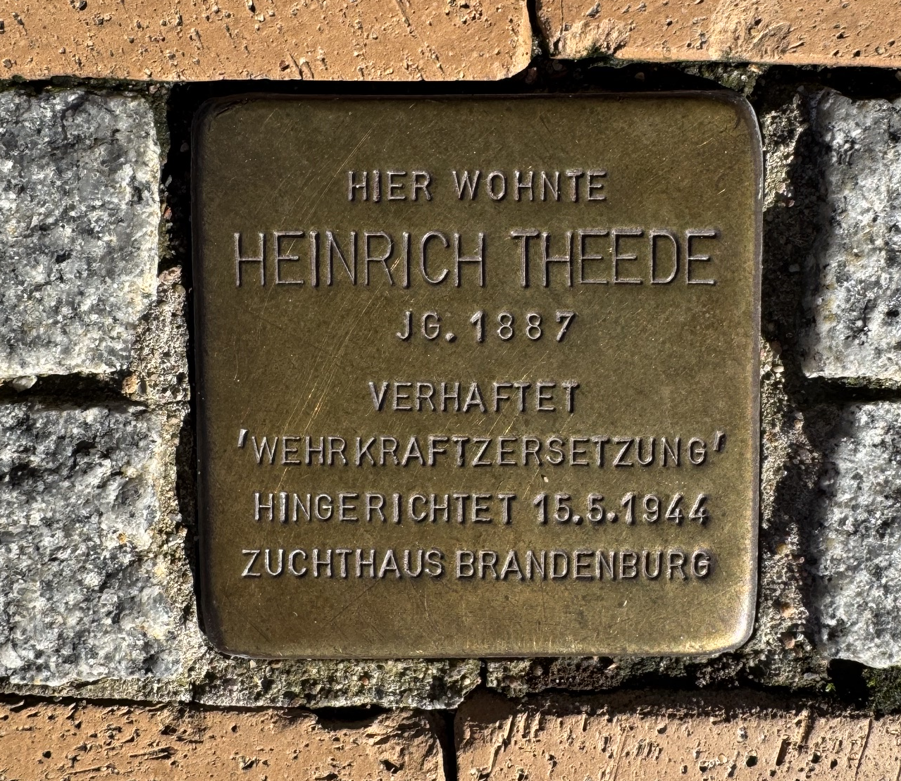

<!--

author: Swantje Piotrowski, Britta Petersen
version: 0.1
language: de

-->

# Offene Daten – offenes Wissen? Daten, Räume und Visualisierungen als Instrumente digitaler Geschichtsvermittlung

Ein Aufbauseminar zur Geschichte der Neuzeit (WS 2026/27)

**Dozierende:**

* Britta Petersen, Zentrales Forschungsdatenmanagement, CAU
* Dr. Swantje Piotrowski, Historsiches Seminar, CAU

**Zeit und Raum:** Do 10:15 - 11:45, UB Kiel, DLL

---

**Inhalt:**

Daten sind zu einer wichtigen Grundlage historischer Forschung geworden. Digitale Datensammlungen eröffnen neue Möglichkeiten, historische Entwicklungen zu analysieren und sichtbar zu machen. Mit der wachsenden Verfügbarkeit offener Datenbestände entstehen neue digitale Quellenräume, die historische Forschung und Geschichtsvermittlung erweitern. Zugleich werfen sie Fragen nach Herkunft, Qualität, Vollständigkeit und Nachnutzbarkeit von Daten auf.

Das Seminar widmet sich der Recherche und Analyse historisch relevanter Datensätze aus offenen Datenportalen. Im Mittelpunkt stehen Fragen nach Herkunft, Qualität, Lizenzierung und Nachnutzbarkeit von Daten sowie nach den Möglichkeiten und Grenzen datenbasierter Wissensproduktion. Auf Grundlage der recherchierten Daten entwickeln die Teilnehmenden eigene digitale Projekte. Die ausgewählten Datensätze werden analysiert, mit weiteren offenen Datenbeständen angereichert und in geeigneten Formaten visualisiert, beispielsweise durch Karten, Diagramme oder interaktive Anwendungen. Ziel ist es, aus Daten neue Perspektiven auf historische Fragestellungen zu gewinnen und digitale Zugänge zur Geschichte zu schaffen. Als Prüfungsleistung ist die Entwicklung eines datenbasierten Projekts einschließlich einer dokumentierten Reflexion der methodischen Entscheidungen und Arbeitsschritte vorgesehen. **Das Seminar wird in Kooperation mit Frau Britta Petersen vom zentralen Forschungsdatenmanagement des Rechenzentrums durchgeführt.**

## Allgemeines

### Semesterplan

**Termine:**

| Datum | Thema/Inhalt |
|-------|--------------|
| 22.10. | Organisatorisches, Leistungsanforderungen, Zielsetzung des Seminars, Erwartungen und Fragen; historische Kontextualisierung |
| 29.10. | Erinnerungskultur, Gedächtnis und Erinnerungsorte; Open Data: Grundlagen, Datenportale und Recherche nach offenen historischen Datensätzen |
| 05.11. | Quellen- und Datenkritik am Beispiel des Stolperstein-Datensatzes Kiel |
| 12.11. | Daten verstehen und aufbereiten; historische Kategorien und mögliche neue Variablen |
| 19.11. | Räumliche Daten und Karten; Einführung in uMap und erste kartografische Exploration |
| 26.11. | Daten anreichern: vom Datensatz zum Forschungsansatz; Forschungsfragen entwickeln |
| 03.12. | Daten analysieren: Muster, Verteilungen und Zusammenhänge; historische Interpretation |
| 10.12. | Daten visualisieren: Diagramme, Karten und Geschichten |
| 17.12. | Vorgaben und Templates für die Projektarbeit; uMap, Datenmodifikation und Ergebnispräsentation |
| 21.12.–03.01. | **UNTERRICHTSFREI** |
| 07.01. | Projektarbeit in Gruppen (anwesend) |
| 14.01. | Projektarbeit (individuell) |
| 21.01. | Projektarbeit (individuell) |
| 28.01. | Peer-Review Projektarbeit |
| 04.02. | Präsentation der Ergebnisse und Evaluation des Seminars |

### Lernziele und weiterführende Links

**Lernziele:**

* fachwissenschaftliche Einordnung von Quellen
* vertiefte fachwissenschaftliche Kenntnisse (Erinnerungskultur, Biographiegeschichte, Public History)
* Methodenkompetenz im Bereich der Digital Humanities
* Visualisierung und Präsentation der Forschungsergebnisse
* Erfahrungen in den Berufs- und Praxisfeldern Wissensvermittlung eigenständiges und selbstorganisiertes Arbeiten

---

**Weiterführende Links und Literatur:**

* Link zum **Stolpersteine Stadt Kiel:** https://www.kiel.de/de/kultur_freizeit/stadtgeschichte/stolpersteine.php
* Link zum **Stolperseteine WIKI:** https://de.wikipedia.org/wiki/Liste_der_Stolpersteine_in_Kiel
* Link zum **Open Data SH**: https://opendata.schleswig-holstein.de/dataset/

### Prüfungsleistung

Erstellung eines eigenen datenbasierten Projektes und eine schriftliche Stellungnahme (4-6 Seiten) mit individueller Reflexion des Arbeitsprozesses.

Details folgen im Laufe des Semesters.

### "Regierungserklärung"

1. Diese Veranstaltung ist eine Forschungswerkstatt: Wir setzen neue Methoden und Software ein. Seien Sie also nachsichtig mit uns und mit sich selbst, wenn mal etwas nicht funktioniert wie geplant. Lassen Sie uns zeitnah wissen, wenn Sie Probleme haben, dann findet sich für alles eine Lösung!
2. Weil es sich um eine Forschungswerkstatt handelt, erwarten wir Eigenengagement und Eigeninitiative für das Thema: Sie werden an verschiedenen Stellen selbst recherchieren, arbeiten und experementieren müssen. Im Gegenzug unterstützen wir Sie, wo wir können.
3. Es kann sein, dass Sie in Ihren Biographien wenig oder gar keine Informationen finden: Das ist auch ein Ergebnis, dessen Dokumentation einen Wert hat!
4. Der Seminarplan ist "im Fluss".

## Sitzung 1

Was erzählt uns ein Stolperstein?
---

**Gemeinsame Bildbetrachtung**

* Was sehen wir – und welche Informationen können wir der Inschrift entnehmen?
* Welche Fragen wirft der Stolperstein über Heinrich Theedes Leben und seine Verfolgung auf?
* Was erfahren wir nicht?

---

### Forschungsdaten

{{0-1}}
********************************************************************************

<!-- style="font-size: 30px;" -->
>**Lasst uns kurz gemeinsam sammeln!**
>
>Mit was für Forschungsdaten wird in einem geschichtswissenschaftlichen Forschungsprozess gearbeitet?
>
>**Nennt alle Beispiele, die Euch einfallen!**
>
>https://answergarden.ch/5241607

********************************************************************************

{{1-2}}
********************************************************************************

<iframe src="https://answergarden.ch/5241607" style="border:0px;width:100%;height:500px" allowfullscreen="true" webkitallowfullscreen="true" mozallowfullscreen="true"></iframe>

********************************************************************************

{{2-3}}
********************************************************************************

<!-- style="font-size: 25px;" -->
Die DFG schreibt hierzu:

<!-- style="font-size: 25px;" -->
> „Zu Forschungsdaten zählen u. a. Messdaten, Laborwerte, audiovisuelle Informationen, Texte, Surveydaten oder Beobachtungsdaten, methodische Testverfahren sowie Fragebögen. Korpora und Simulationen können ebenfalls zentrale Ergebnisse wissenschaftlicher Forschung darstellen und werden daher ebenfalls unter den Begriff Forschungsdaten gefasst. Da Forschungsdaten in einigen Fachbereichen auf der Analyse von Objekten basieren (z. B. Gewebe-, Material-, Gesteins-, Wasser- und Bodenproben, Prüfkörper, Installationen, Artefakte und Kunstgegenstände), muss der Umgang mit diesen ebenso sorgfältig sein und eine fachlich adäquate Nachnutzungsmöglichkeit, wann immer sinnvoll und möglich, mitgedacht werden. Ähnliches gilt, wenn Software für die Entstehung oder Verarbeitung von Forschungsdaten erforderlich ist.“
>
> (**DFG 2021**)

***********************************************************

{{3}}
***********************************************************

 <!-- width="350px" align="right" -->

<!-- style="font-size: 25px;" -->
**Beispiele für Forschungsdaten**:

- Audio- und Videoaufzeichnungen
- Tagebücher
- Geodaten
- Labor- und Feldnotizen
- Modell-, Skript- und Forschungssoftwarecode
- Bilder und Abbildungen
- Fragebögen und Codebücher
- physische Proben und Artefakte
- Sensor-Daten
- Sequenzierdaten
- Spektren
- Text- und Tabellenkalkulationsdokumente
- Textkorpora und Annotationen
- …

********************************************************************************

### Ähnlich, aber nicht gleich!

>[!IMPORTANT] Forschungsdaten, Datensatz, Informationen und Evidenz: ähnliche Begriffe, die wir trotzdem auseinanderhalten müssen. ACHTUNG: Die Bedeutungen der Begriffe können sich in Fachbereichen unterscheiden!

---

<!-- style="font-size: 18px;" -->
| Begriff  | Bedeutung | Beispiel |
| -------- | --------  | -------- |
| ***Forschungsdaten***     | Materialien und Belege, die der Forschung dienen | Historische Dokumente, Interviewtranskript, Code |
| ***Datensatz***           | Strukturierte Sammlung zusammenhängender Daten, in der Regel begleitet von Dokumentation | Eine CSV-Datei mit transkribierten Angaben aus historischen Meldekarten, beispielsweise zu Namen, Wohnorten, Beschäftigungsverhältnissen und Quellenangaben, ergänzt durch ein Codebuch und eine README-Datei |
| ***Information***         | Daten, die interpretiert oder in einen Kontext gestellt wurden | Die Auswertung von Meldekarten zeigt, dass ein großer Teil der dokumentierten Zwangsarbeiter:innen in Gemeinschaftsunterkünften untergebracht war. |
| ***Evidenz***             | Daten oder Informationen, die zur Untermauerung oder Anfechtung einer Behauptung herangezogen werden | Die These, dass Zwangsarbeiter:innen überwiegend in Gemeinschaftsunterkünften untergebracht waren, wird durch die ausgewerteten Meldekarten gestützt. |
| ***Forschungsergebnis***  | Ein Ergebnis der Forschung | Ein wissenschaftlicher Artikel zur Wohnsituation von Zwangsarbeitern, eine kommentierte digitale Karte der Unterkünfte, eine Ausstellung zur Wohnsituation von Zwangsarbeiter:innen |

<small>Source: Adapted from [Hassan, M. (2026, June 28). Research Data – Definition, Types, Examples and Best Practices. Research Method.](https://researchmethod.net/research-data/)</small>

### Heinrich Theede: Was wissen wir – und was bleibt offen?

**Die biografische Recherche von 2008**

* **1887:** Geburt in Segeberg.
* **5. Oktober 1943:** Inhaftierung in Kiel in sogenannter „Schutzhaft“.
* **10. Dezember 1943:** Überstellung an die Gestapo in Berlin.
* **Mai 1944:** Hinrichtung im Zuchthaus Brandenburg-Görden wegen „Wehrkraftzersetzung“.

**Quellenkritische Fragen**

* Was bedeutet der Vorwurf „Wehrkraftzersetzung“ im historischen Kontext?
* Welche Stationen seines Verfolgungswegs lassen sich rekonstruieren – und welche nicht?
* Auf dem Stein steht der **15. Mai 1944**. Die Recherche nennt den **15. oder 19. Mai 1944**. Was geschieht mit historischer Unsicherheit, wenn sie in eine Gedenkinschrift übersetzt wird?

**Quelle:** [Biografische Schülerrecherche zu Heinrich Theede (2008), AKENS (PDF)](https://www.akens.org/akens/texte/stolpersteine/kiel_verdi/theede2008.pdf)

### Aufgabe zur nächsten Woche

Bitte lesen Sie zur nächsten Woche die folgenden Artikel:

* [Christop Cornelißen](https://docupedia.de/zg/cornelissen_erinnerungskulturen_v2_de_2012)
* [Beate Meyer](https://www.stolpersteine-hamburg.de/?MAIN_ID=6&RECORD_ID=561)

 

Wählen Sie anschließend einen Kieler Stolperstein aus (falls möglich, in Ihrer Nähe oder mit Bezug) und recherchieren Sie die dazu verfügbaren biografischen Informationen.

Bearbeiten Sie folgende Fragen:

1. Welche historischen Informationen lassen sich über die Person rekonstruieren? Welche Fragen bleiben offen?
2. Was erfahren Sie über die Entstehung des Stolpersteins und die heutige Erinnerung an diese Person?
3. In welchen Formen liegen die Informationen vor, die Sie für Ihre Recherche nutzen (z. B. historische Dokumente, Fotografien, Zeitzeug:innen, Videoaufzeichnungen, ...)? Welche dieser Materialien können als Forschungsdaten dienen, und welche Informationen lassen sich daraus gewinnen?

Halten Sie Ihre Überlegungen in Stichpunkten fest (max. eine Seite). Bringen Sie Ihre Ergebnisse zur nächsten Sitzung mit.

## Sitzung 2

## Erinnerungskulturen

### Wie definiert Christoph Cornelißen Erinnerungskultur?

**Enges Begriffsverständnis**

Im engeren Sinne bezeichnet Erinnerungskultur den öffentlichen Umgang mit Geschichte außerhalb der Geschichtswissenschaft, etwa durch Denkmäler, Gedenkveranstaltungen, Ausstellungen oder Filme.

**Weites Begriffsverständnis**

Er versteht Erinnerungskultur als „einen formalen Oberbegriff für alle denkbaren Formen der bewussten Erinnerung an historische Ereignisse, Persönlichkeiten und Prozesse“.

Diese Erinnerung kann laut Cornelißen **ästhetischer, politischer oder kognitiver Natur** sein.

<small>Quelle: Christoph Cornelißen, „Erinnerungskulturen“ (2012)</small>

---

### Welche Merkmale sind für Cornelißens Definition entscheidend?

| **Merkmal** | **Erläuterung** |
|---|---|
| **Vielfalt der Formen** | Erinnerung findet durch Texte, Bilder, Denkmäler, Gebäude, Rituale oder wissenschaftliche Darstellungen statt. |
| **Unterschiedliche Träger** | Individuen, gesellschaftliche Gruppen und Nationen gestalten Erinnerung. |
| **Gegenwartsbezug** | Vergangenheit wird erinnert, um gegenwärtige Bedürfnisse zu erfüllen und Identität zu stiften. |

<small>Quelle: Christoph Cornelißen, „Erinnerungskulturen“ (2012)</small>

---

### Maurice Halbwachs – Das kollektive Gedächtnis

**Was versteht man unter dem kollektiven Gedächtnis?**

- Erinnerungen sind nicht ausschließlich individuell, sondern entstehen innerhalb **sozialer Bezugsrahmen**.

- Soziale Gruppen prägen, **was erinnert wird und wie Erinnerungen rekonstruiert werden**.

- Das kollektive Gedächtnis ist an die **Erfahrungen, Perspektiven und Bedürfnisse** der jeweiligen Gruppe gebunden.

- Unterschiedliche Gruppen können deshalb **unterschiedliche Erinnerungen an dieselbe Vergangenheit** entwickeln.

<small>Quelle: Christoph Cornelißen, „Erinnerungskulturen“ (2012)</small>

---

### Jan und Aleida Assmann – Kommunikatives und kulturelles Gedächtnis

| **Kommunikatives Gedächtnis** | **Kulturelles Gedächtnis** |
|---|---|
| Persönliche Erfahrungen und mündliche Überlieferung | Überlieferung durch Texte, Bilder und Rituale |
| Gesellschaftliches „Kurzzeitgedächtnis“ (ca. drei Generationen) | Langfristiges, generationenübergreifendes Gedächtnis |
| Erinnerung innerhalb einer Erfahrungs- und Erzählgemeinschaft | Vermittelt und stabilisiert das Selbstbild einer Gesellschaft |

<small>Quelle: Christoph Cornelißen, „Erinnerungskulturen“ (2012)</small>

---

### Stolpersteine als Teil gesellschaftlicher Erinnerungskultur

- **Öffentliches Gedenken:** Stolpersteine erinnern im alltäglichen Lebensumfeld an Menschen, die während der NS-Zeit verfolgt und ermordet wurden.

- **Gesellschaftliche Gestaltung:** Angehörige, Initiativen und lokale Gemeinschaften beteiligen sich daran, individuelle Lebensgeschichten zu erforschen und sichtbar zu machen.

- **Gegenwartsbezug:** Die Stolpersteine zeigen, wie sich die heutige Gesellschaft mit der NS-Vergangenheit auseinandersetzt und welche Bedeutung sie dem Gedenken beimisst.

- **Weitergabe von Erinnerung:** Als dauerhafte Erinnerungszeichen tragen Stolpersteine dazu bei, das Wissen über individuelle Verfolgungsschicksale über Generationen hinweg zu bewahren.

---

### Gruppenarbeit: Stolpersteine – Biografien und Erinnerung

**25 Minuten Bearbeitung / ca. 5 Minuten Vorstellung pro Gruppe**

Stellen Sie sich in Gruppen von drei bis vier Personen Ihre ausgewählten Stolpersteine vor. Vergleichen Sie anschließend:

1. **Biografische Informationen:** Welche Informationen konnten Sie rekonstruieren? Wo zeigen sich Lücken oder Unsicherheiten?

2. **Quellen und Erinnerungskultur:** Welche Quellen und digitalen Materialien standen zur Verfügung? Was erfahren Sie darüber, wie heute an die Personen erinnert wird?

---

### Von der Biografie zu Forschungsdaten

Überlegen Sie anhand Ihres ausgewählten Stolpersteins, wie sich Ihre Rechercheergebnisse in **strukturierte Forschungsdaten** überführen lassen.

**Beispielsweise:**

| **Datenfeld** | **Beispiel** |
|---|---|
| Name | Vor- und Nachname |
| Geburtsjahr | 1898 |
| Historische Adresse | Straße und Hausnummer |
| Verfolgungsschicksal | Freitext oder Kategorie |
| Stolperstein-Standort | Heutige Adresse |
| Verlegedatum | Falls bekannt |
| Quellen | Archivsignatur, Literatur, Webseite |
| Unsicherheiten | Fehlende oder widersprüchliche Angaben |

---

### Open Data?

**Was bedeutet es, wenn Daten "offen" sind?**
---

---

 

oder anders:

>**Welche der folgenden Aussagen treffen auf _Open Data_ zu?**
>
>[[X]] Die Daten sind kostenlos zugänglich.
>[[ ]] Die Daten dürfen ausschließlich für wissenschaftliche Zwecke genutzt werden.
>[[X]] Die Daten dürfen unter bestimmten Bedingungen weiterverwendet werden.
>[[X]] Die Nutzungsbedingungen erlauben eine Weiterverwendung, auch durch Dritte.
>[[ ]] Alle im Internet verfügbaren Daten sind Open Data.
>

### Open Data Definition

{{0-1}}
**************

>Bitkom (2017): „Open Data Manifest“, derived from Jesper Zedlitz (2025): "Open Data in Schleswig-Holstein" 2025
>
> -- **Open Data sind ungefilterte, maschinenlesbare elektronische Daten, die jedem öffentlich, zweckfrei und unverbindlich zur Verfügung gestellt werden.**

**************

{{1}}
**************

Open Data...
--- 

...sind Daten, die **grundsätzlich für alle zugänglich** sind und **unter solchen Bedingungen** bereitgestellt werden, die eine **freie Weiterverwendung** ermöglichen.

---

Je nach **Lizenz** können offene Daten:

- heruntergeladen und gespeichert,
- analysiert und ausgewertet,
- verändert und mit anderen Daten kombiniert,
- veröffentlicht und weitergegeben werden.

Beispiele für mögliche *Bedingungen*:

- Pflicht, die Quelle zu nennen ([CC BY 4.0](https://creativecommons.org/licenses/by/4.0/))
- unter den selben Bedingungen veröffentlichen. ([CC BY SA](https://creativecommons.org/licenses/by-sa/4.0/))

**************

{{2}}
**************

Open Data bedeutet nicht,...
---

- dass Daten automatisch vertrauenswürdig sind,
- dass Daten fehlerfrei oder vollständig sind,
- dass sie ohne technische Aufbereitung verwendbar sind,
- dass keine Lizenzbedingungen zu beachten sind,
- dass alle enthaltenen Informationen automatisch uneingeschränkt veröffentlicht werden dürfen.

**************

### Fünf-Sterne-Modell zu offenen Daten

Um den **Grad der Offenheit** von Datensätzen zu klassifizieren, wird auf das "Fünf-Sterne-Modell" zurückgegriffen:

Das Fünf-Sterne-Modell ist kaskadierend: Den zweiten Stern bekommen Datensätze nur, wenn bereits die Voraussetzungen für den ersten Stern erfüllt. Voraussetzung für den ersten Stern ist die **offene Lizenz**.

| Sterne | Bedingungen |
|---|---|
|  | Keine offene Lizenz |
| ⭐ | Daten im Web (Dateiformat egal) mit offener Lizenz |
| ⭐⭐ | Verfügbar als maschinenlesbare strukturierte Daten (z. B. Excel statt eines gescannten Bildes einer Tabelle) |
| ⭐⭐⭐ | Daten in strukturiertem, nicht proprietärem Format (z.B. CSV statt Excel) |
| ⭐⭐⭐⭐ | All das und noch dazu: Verwendung von eindeutigen URLs, so dass Datensätze verlinkt werden können |
| ⭐⭐⭐⭐⭐ | All das und noch dazu: Verknüpfung der Daten mit denen anderer, um einen Kontext zu schaffen |

---

Weiterlesen:
---
- https://opendatahandbook.org/guide/en/what-is-open-data/
- https://www.w3.org/DesignIssues/LinkedData.html 

### Offene Lizenzen

{{0-1}}
**************

Die Wahl der **Lizenz** entscheidet darüber, wie offen und frei nachnutzbar Daten tatsächlich sind.

Eine klare und verständliche Lizenz schafft **Rechtssicherheit** sowohl für Datenbereitstellende als auch für Datennutzende.

Es existieren verschiedene Lizenzsysteme. Darunter sind die [Creative Commons (CC) Lizenzen](https://creativecommons.org/cc-licenses/) die weltweit etabliertesten.

<iframe src="https://creativecommons.org/cc-licenses/" style="border:1px;width:100%;height:500px" allowfullscreen="true" webkitallowfullscreen="true" mozallowfullscreen="true"></iframe>

---

**************

{{1}}
**************

Welche der [Creative Commons (CC) Lizenzen](https://creativecommons.org/cc-licenses/) gelten als **offene Lizenzen**?

**************

{{2}}
**************

>[!IMPORTANT] Nur CC-0, CC-BY und CC-BY-SA gelten als offene Lizenzen!
>
>Eine Übersicht über komforme Lizenzen findet sich z. B. hier: https://opendefinition.org/licenses/ 

**************

### Open Data finden und bewerten

{{0-1}}
**************
Wo finden wir Offene Daten?

- kurzes Brainstorming

<iframe src="https://zumpad.zum.de/p/opendata-finden " style="border:1px;width:100%;height:500px" allowfullscreen="true" webkitallowfullscreen="true" mozallowfullscreen="true"></iframe>

---

{{1-2}}
**************
<iframe src="https://opendata.schleswig-holstein.de/dataset" style="border:1px;width:100%;height:500px" allowfullscreen="true" webkitallowfullscreen="true" mozallowfullscreen="true"></iframe>

{{2}}
**************

Suchen und bewerten 
---

Findet folgende Ressourcen und bewertet, ob es sich bei den jeweiligen Ressourcen um Open Data handelt:

1. Stolpersteine als Erinnerungsmarker und Lerngelegenheiten im europäischen urbanen Strassenbild, Christian Mathis

2. Luftbild mit Blick über die durch Bomben nördlich vom Dreiecksplatz zerstörten, von der Holtenauer Straße links und rechts abgehenden Straßenzüge.

3. Vornehmheit und Tüchtigkeit. Dem deutschen Volke zur Einkehr, Havenstein, Martin 

4. **Einen Datensatz zu Stolpersteinen im Stadtgebiet Kiel**

