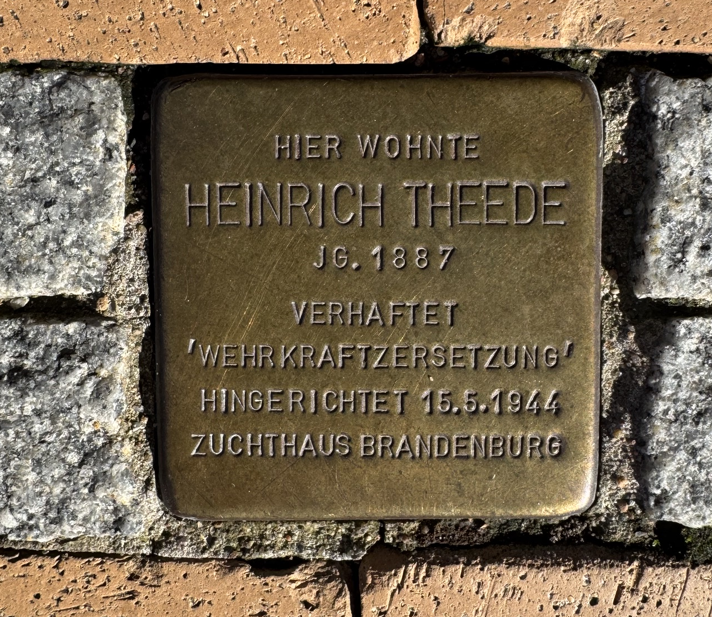
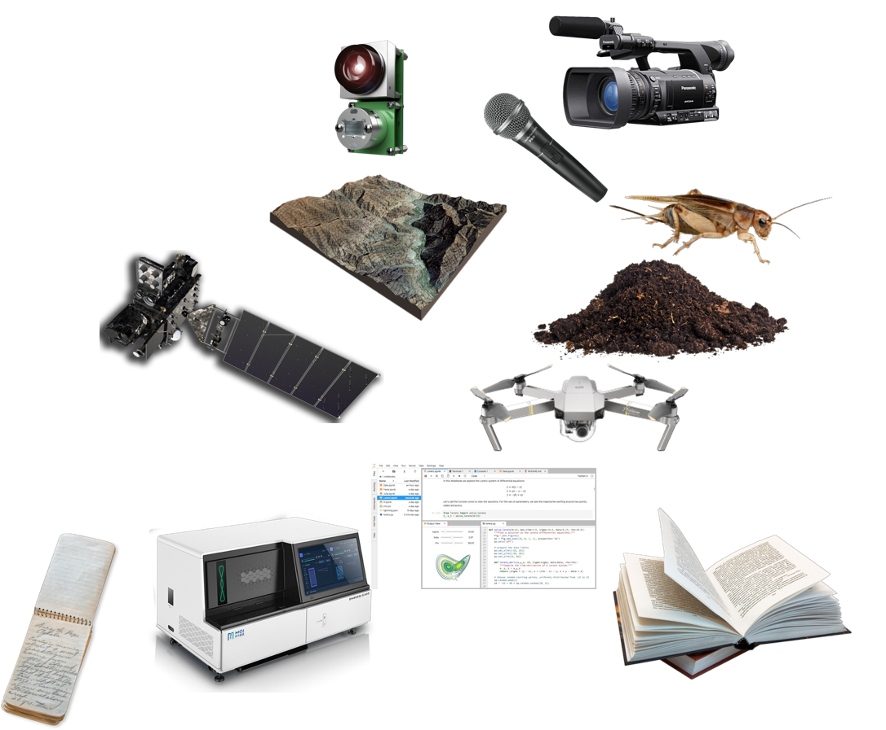
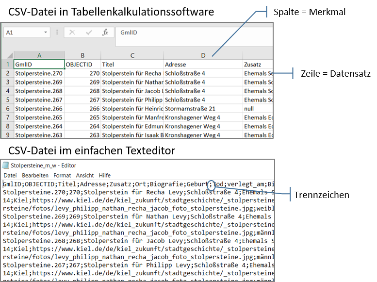
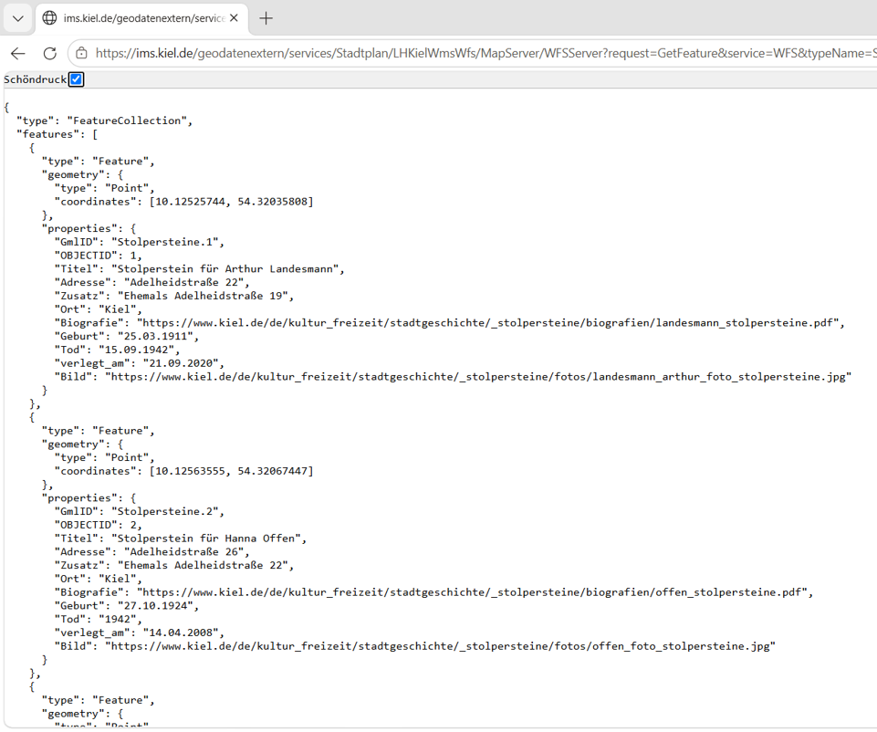
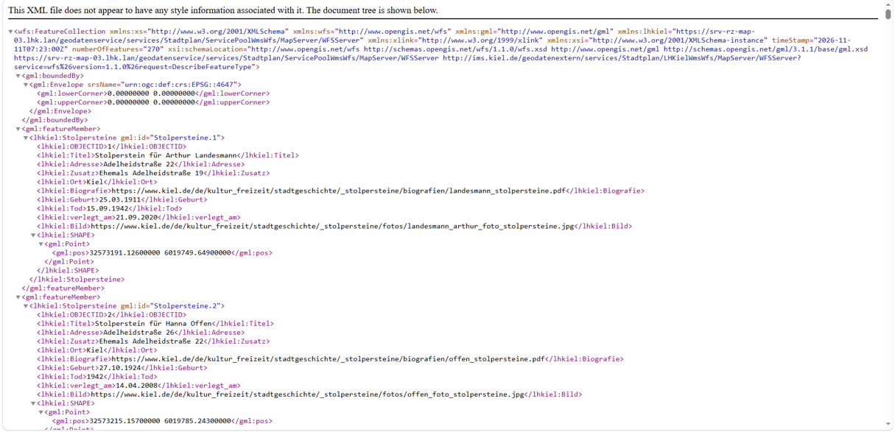

<!--

author: Swantje Piotrowski, Britta Petersen
version: 0.1
language: de

-->

# Offene Daten – offenes Wissen? Daten, Räume und Visualisierungen als Instrumente digitaler Geschichtsvermittlung

Ein Aufbauseminar zur Geschichte der Neuzeit (WS 2026/27)

**Dozierende:**

* Britta Petersen, Zentrales Forschungsdatenmanagement, CAU
* Dr. Swantje Piotrowski, Historsiches Seminar, CAU

**Zeit und Raum:** Do 10:15 - 11:45, UB Kiel, DLL

---

**Inhalt:**

Daten sind zu einer wichtigen Grundlage historischer Forschung geworden. Digitale Datensammlungen eröffnen neue Möglichkeiten, historische Entwicklungen zu analysieren und sichtbar zu machen. Mit der wachsenden Verfügbarkeit offener Datenbestände entstehen neue digitale Quellenräume, die historische Forschung und Geschichtsvermittlung erweitern. Zugleich werfen sie Fragen nach Herkunft, Qualität, Vollständigkeit und Nachnutzbarkeit von Daten auf.

Das Seminar widmet sich der Recherche und Analyse historisch relevanter Datensätze aus offenen Datenportalen. Im Mittelpunkt stehen Fragen nach Herkunft, Qualität, Lizenzierung und Nachnutzbarkeit von Daten sowie nach den Möglichkeiten und Grenzen datenbasierter Wissensproduktion. Auf Grundlage der recherchierten Daten entwickeln die Teilnehmenden eigene digitale Projekte. Die ausgewählten Datensätze werden analysiert, mit weiteren offenen Datenbeständen angereichert und in geeigneten Formaten visualisiert, beispielsweise durch Karten, Diagramme oder interaktive Anwendungen. Ziel ist es, aus Daten neue Perspektiven auf historische Fragestellungen zu gewinnen und digitale Zugänge zur Geschichte zu schaffen. Als Prüfungsleistung ist die Entwicklung eines datenbasierten Projekts einschließlich einer dokumentierten Reflexion der methodischen Entscheidungen und Arbeitsschritte vorgesehen. **Das Seminar wird in Kooperation mit Frau Britta Petersen vom zentralen Forschungsdatenmanagement des Rechenzentrums durchgeführt.**

## Allgemeines

### Semesterplan

**Termine:**

| Datum | Thema/Inhalt |
|-------|--------------|
| 22.10. | Organisatorisches, Leistungsanforderungen, Zielsetzung des Seminars, Erwartungen und Fragen; historische Kontextualisierung |
| 29.10. | Erinnerungskultur, Gedächtnis und Erinnerungsorte; Open Data: Grundlagen, Datenportale und Recherche nach offenen historischen Datensätzen |
| 05.11. | Quellen- und Datenkritik am Beispiel des Stolperstein-Datensatzes Kiel |
| 12.11. | Daten verstehen und aufbereiten; historische Kategorien und mögliche neue Variablen |
| 19.11. | Räumliche Daten und Karten; Einführung in uMap und erste kartografische Exploration |
| 26.11. | Daten anreichern: vom Datensatz zum Forschungsansatz; Forschungsfragen entwickeln |
| 03.12. | Daten analysieren: Muster, Verteilungen und Zusammenhänge; historische Interpretation |
| 10.12. | Daten visualisieren: Diagramme, Karten und Geschichten |
| 17.12. | Vorgaben und Templates für die Projektarbeit; uMap, Datenmodifikation und Ergebnispräsentation |
| 21.12.–03.01. | **UNTERRICHTSFREI** |
| 07.01. | Projektarbeit in Gruppen (anwesend) |
| 14.01. | Projektarbeit (individuell) |
| 21.01. | Projektarbeit (individuell) |
| 28.01. | Peer-Review Projektarbeit |
| 04.02. | Präsentation der Ergebnisse und Evaluation des Seminars |

### Lernziele und weiterführende Links

**Lernziele:**

* fachwissenschaftliche Einordnung von Quellen
* vertiefte fachwissenschaftliche Kenntnisse (Erinnerungskultur, Biographiegeschichte, Public History)
* Methodenkompetenz im Bereich der Digital Humanities
* Visualisierung und Präsentation der Forschungsergebnisse
* Erfahrungen in den Berufs- und Praxisfeldern Wissensvermittlung eigenständiges und selbstorganisiertes Arbeiten

---

**Weiterführende Links und Literatur:**

* Link zum **Stolpersteine Stadt Kiel:** https://www.kiel.de/de/kultur_freizeit/stadtgeschichte/stolpersteine.php
* Link zum **Stolperseteine WIKI:** https://de.wikipedia.org/wiki/Liste_der_Stolpersteine_in_Kiel
* Link zum **Open Data SH**: https://opendata.schleswig-holstein.de/dataset/

### Prüfungsleistung

Erstellung eines eigenen datenbasierten Projektes und eine schriftliche Stellungnahme (4-6 Seiten) mit individueller Reflexion des Arbeitsprozesses.

Details folgen im Laufe des Semesters.

### "Regierungserklärung"

1. Diese Veranstaltung ist eine Forschungswerkstatt: Wir setzen neue Methoden und Software ein. Seien Sie also nachsichtig mit uns und mit sich selbst, wenn mal etwas nicht funktioniert wie geplant. Lassen Sie uns zeitnah wissen, wenn Sie Probleme haben, dann findet sich für alles eine Lösung!
2. Weil es sich um eine Forschungswerkstatt handelt, erwarten wir Eigenengagement und Eigeninitiative für das Thema: Sie werden an verschiedenen Stellen selbst recherchieren, arbeiten und experementieren müssen. Im Gegenzug unterstützen wir Sie, wo wir können.
3. Es kann sein, dass Sie in Ihren Biographien wenig oder gar keine Informationen finden: Das ist auch ein Ergebnis, dessen Dokumentation einen Wert hat!
4. Der Seminarplan ist "im Fluss".

## Sitzung 1

<!-- align="right" -->
2026-10-22

Was erzählt uns ein Stolperstein?
---



**Gemeinsame Bildbetrachtung**

* Was sehen wir – und welche Informationen können wir der Inschrift entnehmen?
* Welche Fragen wirft der Stolperstein über Heinrich Theedes Leben und seine Verfolgung auf?
* Was erfahren wir nicht?

---

### Forschungsdaten

{{0-1}}
********************************************************************************

<!-- style="font-size: 30px;" -->
>**Lasst uns kurz gemeinsam sammeln!**
>
>Mit was für Forschungsdaten wird in einem geschichtswissenschaftlichen Forschungsprozess gearbeitet?
>
>**Nennt alle Beispiele, die Euch einfallen!**
>
>https://answergarden.ch/5241607

********************************************************************************

{{1-2}}
********************************************************************************

<iframe src="https://answergarden.ch/5241607" style="border:0px;width:100%;height:500px" allowfullscreen="true" webkitallowfullscreen="true" mozallowfullscreen="true"></iframe>

<div style="page-break-after: always;"></div>

********************************************************************************

{{2-3}}
********************************************************************************

<!-- style="font-size: 25px;" -->
Die DFG schreibt hierzu:

<!-- style="font-size: 25px;" -->
> „Zu Forschungsdaten zählen u. a. Messdaten, Laborwerte, audiovisuelle Informationen, Texte, Surveydaten oder Beobachtungsdaten, methodische Testverfahren sowie Fragebögen. Korpora und Simulationen können ebenfalls zentrale Ergebnisse wissenschaftlicher Forschung darstellen und werden daher ebenfalls unter den Begriff Forschungsdaten gefasst. Da Forschungsdaten in einigen Fachbereichen auf der Analyse von Objekten basieren (z. B. Gewebe-, Material-, Gesteins-, Wasser- und Bodenproben, Prüfkörper, Installationen, Artefakte und Kunstgegenstände), muss der Umgang mit diesen ebenso sorgfältig sein und eine fachlich adäquate Nachnutzungsmöglichkeit, wann immer sinnvoll und möglich, mitgedacht werden. Ähnliches gilt, wenn Software für die Entstehung oder Verarbeitung von Forschungsdaten erforderlich ist.“
>
> (**DFG 2021**)

***********************************************************

{{3}}
***********************************************************

 <!-- width="350px" align="right" -->

<!-- style="font-size: 25px;" -->
**Beispiele für Forschungsdaten**:

- Audio- und Videoaufzeichnungen
- Tagebücher
- Geodaten
- Labor- und Feldnotizen
- Modell-, Skript- und Forschungssoftwarecode
- Bilder und Abbildungen
- Fragebögen und Codebücher
- physische Proben und Artefakte
- Sensor-Daten
- Sequenzierdaten
- Spektren
- Text- und Tabellenkalkulationsdokumente
- Textkorpora und Annotationen
- …

********************************************************************************

<div style="page-break-after: always;"></div>

### Ähnlich, aber nicht gleich!

>[!IMPORTANT] Forschungsdaten, Datensatz, Informationen und Evidenz: ähnliche Begriffe, die wir trotzdem auseinanderhalten müssen. ACHTUNG: Die Bedeutungen der Begriffe können sich in Fachbereichen unterscheiden!

---

<!-- style="font-size: 18px;" -->
| Begriff  | Bedeutung | Beispiel |
| -------- | --------  | -------- |
| ***Forschungsdaten***     | Materialien und Belege, die der Forschung dienen | Historische Dokumente, Interviewtranskript, Code |
| ***Datensatz***           | Strukturierte Sammlung zusammenhängender Daten, in der Regel begleitet von Dokumentation | Eine CSV-Datei mit transkribierten Angaben aus historischen Meldekarten, beispielsweise zu Namen, Wohnorten, Beschäftigungsverhältnissen und Quellenangaben, ergänzt durch ein Codebuch und eine README-Datei |
| ***Information***         | Daten, die interpretiert oder in einen Kontext gestellt wurden | Die Auswertung von Meldekarten zeigt, dass ein großer Teil der dokumentierten Zwangsarbeiter:innen in Gemeinschaftsunterkünften untergebracht war. |
| ***Evidenz***             | Daten oder Informationen, die zur Untermauerung oder Anfechtung einer Behauptung herangezogen werden | Die These, dass Zwangsarbeiter:innen überwiegend in Gemeinschaftsunterkünften untergebracht waren, wird durch die ausgewerteten Meldekarten gestützt. |
| ***Forschungsergebnis***  | Ein Ergebnis der Forschung | Ein wissenschaftlicher Artikel zur Wohnsituation von Zwangsarbeitern, eine kommentierte digitale Karte der Unterkünfte, eine Ausstellung zur Wohnsituation von Zwangsarbeiter:innen |

<small>Source: Adapted from [Hassan, M. (2026, June 28). Research Data – Definition, Types, Examples and Best Practices. Research Method.](https://researchmethod.net/research-data/)</small>


### Heinrich Theede: Was wissen wir – und was bleibt offen?

**Die biografische Recherche von 2008**

* **1887:** Geburt in Segeberg.
* **5. Oktober 1943:** Inhaftierung in Kiel in sogenannter „Schutzhaft“.
* **10. Dezember 1943:** Überstellung an die Gestapo in Berlin.
* **Mai 1944:** Hinrichtung im Zuchthaus Brandenburg-Görden wegen „Wehrkraftzersetzung“.

**Quellenkritische Fragen**

* Was bedeutet der Vorwurf „Wehrkraftzersetzung“ im historischen Kontext?
* Welche Stationen seines Verfolgungswegs lassen sich rekonstruieren – und welche nicht?
* Auf dem Stein steht der **15. Mai 1944**. Die Recherche nennt den **15. oder 19. Mai 1944**. Was geschieht mit historischer Unsicherheit, wenn sie in eine Gedenkinschrift übersetzt wird?

**Quelle:** [Biografische Schülerrecherche zu Heinrich Theede (2008), AKENS (PDF)](https://www.akens.org/akens/texte/stolpersteine/kiel_verdi/theede2008.pdf)

### Aufgabe zur nächsten Woche

Bitte lesen Sie zur nächsten Woche die folgenden Artikel:

* [Christop Cornelißen](https://docupedia.de/zg/cornelissen_erinnerungskulturen_v2_de_2012)
* [Beate Meyer](https://www.stolpersteine-hamburg.de/?MAIN_ID=6&RECORD_ID=561)

<br>

Wählen Sie anschließend einen Kieler Stolperstein aus (falls möglich, in Ihrer Nähe oder mit Bezug) und recherchieren Sie die dazu verfügbaren biografischen Informationen.

Bearbeiten Sie folgende Fragen:

1. Welche historischen Informationen lassen sich über die Person rekonstruieren? Welche Fragen bleiben offen?
2. Was erfahren Sie über die Entstehung des Stolpersteins und die heutige Erinnerung an diese Person?
3. In welchen Formen liegen die Informationen vor, die Sie für Ihre Recherche nutzen (z. B. historische Dokumente, Fotografien, Zeitzeug:innen, Videoaufzeichnungen, ...)? Welche dieser Materialien können als Forschungsdaten dienen, und welche Informationen lassen sich daraus gewinnen?

Halten Sie Ihre Überlegungen in Stichpunkten fest (max. eine Seite). Bringen Sie Ihre Ergebnisse zur nächsten Sitzung mit.

## Sitzung 2

<!-- align="right" -->
2026-10-29

### Wie definiert Christoph Cornelißen Erinnerungskultur?

{{1-2}}
********************************************************************************

**Enges Begriffsverständnis**

Öffentlicher Umgang mit Geschichte außerhalb der Geschichtswissenschaft, etwa durch Denkmäler, Gedenkveranstaltungen, Ausstellungen oder Filme.

********************************************************************************

{{2-3}}
********************************************************************************

**Weites Begriffsverständnis**

Erinnerungskultur als „einen formalen Oberbegriff für alle denkbaren Formen der bewussten Erinnerung an historische Ereignisse, Persönlichkeiten und Prozesse“.

Diese Erinnerung kann **ästhetischer, politischer oder kognitiver Natur** sein.

********************************************************************************

{{3}}
********************************************************************************

**Zentrale Merkmale der Erinnerungskultur**

| **Merkmal** | **Erläuterung** |
|---|---|
| **Vielfalt der Formen** | Texte, Bilder, Denkmäler, Rituale oder wissenschaftliche Darstellungen |
| **Unterschiedliche Träger** | Individuen, gesellschaftliche Gruppen und Nationen |
| **Gegenwartsbezug** | Erinnerung orientiert sich an gegenwärtigen Bedürfnissen und kann Identität stiften |

********************************************************************************

<small>Quelle: Christoph Cornelißen, „Erinnerungskulturen“ (2012)</small>

---


### Kollektives Gedächtnis – Halbwachs und Assmann

**Maurice Halbwachs: Kollektives Gedächtnis**

- Erinnerungen entstehen innerhalb sozialer Gruppen und werden durch deren Erfahrungen und gegenwärtige Perspektiven geprägt.
- Unterschiedliche Gruppen können dieselbe Vergangenheit unterschiedlich erinnern.

**Jan und Aleida Assmann: Zwei Formen des Gedächtnisses**

| **Kommunikatives Gedächtnis** | **Kulturelles Gedächtnis** |
|---|---|
| Persönliche Erfahrungen und mündliche Überlieferung | Erinnerung durch Texte, Bilder und Rituale |
| Zeitlich begrenzt (ca. drei Generationen) | Langfristig und generationenübergreifend |

<small>Quelle: Christoph Cornelißen, „Erinnerungskulturen“ (2012)</small>

---

### Stolpersteine als Teil gesellschaftlicher Erinnerungskultur

- **Öffentliches Gedenken:** Stolpersteine erinnern im alltäglichen Lebensumfeld an Menschen, die während der NS-Zeit verfolgt und ermordet wurden.

- **Gesellschaftliche Gestaltung:** Angehörige, Initiativen und lokale Gemeinschaften beteiligen sich daran, individuelle Lebensgeschichten zu erforschen und sichtbar zu machen.

- **Gegenwartsbezug:** Die Stolpersteine zeigen, wie sich die heutige Gesellschaft mit der NS-Vergangenheit auseinandersetzt und welche Bedeutung sie dem Gedenken beimisst.

- **Weitergabe von Erinnerung:** Als dauerhafte Erinnerungszeichen tragen Stolpersteine dazu bei, das Wissen über individuelle Verfolgungsschicksale über Generationen hinweg zu bewahren.

---

### Gruppenarbeit: Stolpersteine – Biografien und Erinnerung

**25 Minuten Bearbeitung / ca. 5 Minuten Vorstellung pro Gruppe**

Stellen Sie sich in Gruppen von drei bis vier Personen Ihre ausgewählten Stolpersteine vor. Vergleichen Sie anschließend:

1. **Biografische Informationen:** Welche Informationen konnten Sie rekonstruieren? Wo zeigen sich Lücken oder Unsicherheiten?

2. **Quellen und Erinnerungskultur:** Welche Quellen und digitalen Materialien standen zur Verfügung? Was erfahren Sie darüber, wie heute an die Personen erinnert wird?

---

### Von der Biografie zu Forschungsdaten

Überlegen Sie anhand Ihres ausgewählten Stolpersteins, wie sich Ihre Rechercheergebnisse in **strukturierte Forschungsdaten** überführen lassen.

**Beispielsweise:**

| **Datenfeld** | **Beispiel** |
|---|---|
| Vorname | Heinrich |
| Nachname | Theede |
| Geburtsdatum | 1887 |
| Todesdatum | Mai 1944 |
| Historische Adresse | Straße und Hausnummer |
| Verfolgungsschicksal | Freitext oder Kategorie |
| Stolperstein-Standort | Heutige Adresse |
| Verlegedatum | Falls bekannt |
| Quellen | Archivsignatur, Literatur, Webseite |
| Unsicherheiten | Fehlende oder widersprüchliche Angaben |

---


### Open Data?

**Was bedeutet es, wenn Daten "offen" sind?**
---

---

<br>

oder anders:

>**Welche der folgenden Aussagen treffen auf _Open Data_ zu?**
>
>[[X]] Die Daten sind kostenlos zugänglich.
>[[ ]] Die Daten dürfen ausschließlich für wissenschaftliche Zwecke genutzt werden.
>[[X]] Die Daten dürfen unter bestimmten Bedingungen weiterverwendet werden.
>[[X]] Die Nutzungsbedingungen erlauben eine Weiterverwendung, auch durch Dritte.
>[[ ]] Alle im Internet verfügbaren Daten sind Open Data.
>

### Open Data Definition

{{0-1}}
**************

>Bitkom (2017): „Open Data Manifest“, derived from Jesper Zedlitz (2025): "Open Data in Schleswig-Holstein"
>
> -- **Open Data sind ungefilterte, maschinenlesbare elektronische Daten, die jedem öffentlich, zweckfrei und unverbindlich zur Verfügung gestellt werden.**

**************

{{1-2}}
**************

Open Data...
--- 

...sind Daten, die **grundsätzlich für alle zugänglich** sind und **unter solchen Bedingungen** bereitgestellt werden, die eine **freie Weiterverwendung** ermöglichen.

---

Je nach **Lizenz** können offene Daten:

- heruntergeladen und gespeichert,
- analysiert und ausgewertet,
- verändert und mit anderen Daten kombiniert,
- veröffentlicht und weitergegeben werden.

Beispiele für mögliche *Bedingungen*:

- Pflicht, die Quelle zu nennen ([CC BY 4.0](https://creativecommons.org/licenses/by/4.0/))
- unter den selben Bedingungen veröffentlichen. ([CC BY SA](https://creativecommons.org/licenses/by-sa/4.0/))

**************

{{2}}
**************

Open Data bedeutet nicht,...
---

- dass Daten automatisch vertrauenswürdig sind,
- dass Daten fehlerfrei oder vollständig sind,
- dass sie ohne technische Aufbereitung verwendbar sind,
- dass keine Lizenzbedingungen zu beachten sind,
- dass alle enthaltenen Informationen automatisch uneingeschränkt veröffentlicht werden dürfen.

**************

### Fünf-Sterne-Modell zu offenen Daten

Um den **Grad der Offenheit** von Datensätzen zu klassifizieren, wird auf das "Fünf-Sterne-Modell" zurückgegriffen:

Das Fünf-Sterne-Modell ist kaskadierend: Den zweiten Stern bekommen Datensätze nur, wenn bereits die Voraussetzungen für den ersten Stern erfüllt. Voraussetzung für den ersten Stern ist die **offene Lizenz**.

| Sterne | Bedingungen |
|---|---|
|  | Keine offene Lizenz |
| ⭐ | Daten im Web (Dateiformat egal) mit offener Lizenz |
| ⭐⭐ | Verfügbar als maschinenlesbare strukturierte Daten (z. B. Excel statt eines gescannten Bildes einer Tabelle) |
| ⭐⭐⭐ | Daten in strukturiertem, nicht proprietärem Format (z.B. CSV statt Excel) |
| ⭐⭐⭐⭐ | All das und noch dazu: Verwendung von eindeutigen URLs, so dass Datensätze verlinkt werden können |
| ⭐⭐⭐⭐⭐ | All das und noch dazu: Verknüpfung der Daten mit denen anderer, um einen Kontext zu schaffen |

---


Weiterlesen:
---
- https://opendatahandbook.org/guide/en/what-is-open-data/
- https://www.w3.org/DesignIssues/LinkedData.html 


### Offene Lizenzen

{{0-1}}
**************

Die Wahl der **Lizenz** entscheidet darüber, wie offen und frei nachnutzbar Daten tatsächlich sind.

Eine klare und verständliche Lizenz schafft **Rechtssicherheit** sowohl für Datenbereitstellende als auch für Datennutzende.

Es existieren verschiedene Lizenzsysteme. Darunter sind die [Creative Commons (CC) Lizenzen](https://creativecommons.org/cc-licenses/) die weltweit etabliertesten.

<iframe src="https://creativecommons.org/cc-licenses/" style="border:1px;width:100%;height:500px" allowfullscreen="true" webkitallowfullscreen="true" mozallowfullscreen="true"></iframe>

---

**************

{{1}}
**************

Welche der [Creative Commons (CC) Lizenzen](https://creativecommons.org/cc-licenses/) gelten als **offene Lizenzen**?

**************

{{2}}
**************

>[!IMPORTANT] Nur CC-0, CC-BY und CC-BY-SA gelten als offene Lizenzen!
>
>Eine Übersicht über komforme Lizenzen findet sich z. B. hier: https://opendefinition.org/licenses/ 

**************

### Open Data finden und bewerten

{{0-1}}
**************
Wo finden wir offene Daten?

- kurzes Brainstorming

<iframe src="https://zumpad.zum.de/p/opendata-finden " style="border:1px;width:100%;height:500px" allowfullscreen="true" webkitallowfullscreen="true" mozallowfullscreen="true"></iframe>

---

**************

{{1-2}}
**************
<iframe src="https://opendata.schleswig-holstein.de/dataset" style="border:1px;width:100%;height:500px" allowfullscreen="true" webkitallowfullscreen="true" mozallowfullscreen="true"></iframe>

*******************

{{2}}
**************

Suchen und bewerten 
---

Findet folgende Ressourcen und bewertet, ob es sich bei den jeweiligen Ressourcen um Open Data handelt:

1. Stolpersteine als Erinnerungsmarker und Lerngelegenheiten im europäischen urbanen Strassenbild, Christian Mathis

2. Luftbild mit Blick über die durch Bomben nördlich vom Dreiecksplatz zerstörten, von der Holtenauer Straße links und rechts abgehenden Straßenzüge.

3. Vornehmheit und Tüchtigkeit. Dem deutschen Volke zur Einkehr, Havenstein, Martin 

4. **Einen Datensatz zu Stolpersteinen im Stadtgebiet Kiel**

***************

### Aufgabe zur nächsten Woche

Bitte lesen Sie zur nächsten Woche die folgenden Artikel (im Olat-Ordner):

- Frese Matthias, Weidner Matthias (Hg.): Verhandelte Erinnerungen. Der Umgang mit Ehrungen, Denkmälern und Gedenkorten nach 1945, Einleitung S. 7-21.
- Schrader, Ulrike: Die „Stolpersteine“ oder: Von der Leichtigkeit des Gedenkens - Einige kritische Anmerkungen, S. 237-253.

## Sitzung 3

<!-- align="right" -->
2026-11-05

### Von der Biografie zu Forschungsdaten 2

>**Gruppenarbeit**:
>
>Sie haben zum heutigen Termin Ihre Rechercheergebnisse zu einem Kieler Stolperstein in eine Tabelle überführt und damit strukturierte Forschungsdaten generiert.
>
>Vergleichen Sie Ihrer Gruppe den Aufbau der entstandenen Tabellen. Unterscheiden sich die Tabellen in Struktur und/oder den Spaltenbenennungen?
>
>Einigen Sie sich in Ihrer Gruppe auf eine gemeinsame Tabellenstruktur.
>
>Stellen Sie Ihre gemeinsame Tabellenstruktur im Plenum vor. Erläutern Sie dabei kurz Ihre Diskussionen und Entscheidungen.

---
### Diskussionsfrage zu Frese/Weidner und Schrader

{{0}}
********************************************************************************

Warum und durch wen verändert sich die öffentliche Erinnerung an die Vergangenheit und damit auch die Bedeutung von Denkmälern?

********************************************************************************

{{1}}
********************************************************************************

**Kernaussage:** Erinnerungskultur ist nicht unveränderlich, sondern wird gesellschaftlich ausgehandelt und immer wieder neu gestaltet.

********************************************************************************

### Diskussionsfrage zu Ulrike Schrader

{{2}}
********************************************************************************

Welche unterschiedlichen Kritikpunkte am Stolperstein-Projekt nennt Ulrike Schrader?

********************************************************************************

{{3}}
********************************************************************************

**Kernaussage:** Ulrike Schrader kritisiert, dass das Stolperstein-Projekt häufig unhinterfragt Zustimmung findet. Sie fordert eine kritische Auseinandersetzung mit der Form des Gedenkens, der Auswahl der erinnerten Personen und den unterschiedlichen Perspektiven der Betroffenen.

********************************************************************************

### Recap Open Data

Wir haben uns in der letzen Sitzung darüber unterhalten, was **Open Data** ist.

Kurze Widerholung:

**Frage 1: Welche Merkmale zeichnen Open Data aus?** (Mehrere Antworten möglich.)

[[ ]] Kostenfreie Nutzung ausschließlich für wissenschaftliche Zwecke
[[X]] Freier Zugang zu den Daten
[[X]] Angabe einer offenen Lizenz
[[X]] Möglichkeit zur Weiterverbreitung
[[ ]] Verpflichtende Registrierung auf Datenportal bei der Nutzung
[[X]] Möglichkeit zur Bearbeitung

---

**Frage 2: Welche der folgenden Lizenzen eignen sich für die Veröffentlichung von Open Data?** (Mehrere Antworten möglich.)

[[X]] Creative Commons CC BY-SA 4.0
[[ ]] Creative Commons CC BY-NC-ND 4.0
[[X]] Creative Commons CC0
[[ ]] Creative Commons CC BY-NC-SA
[[ ]] Creative Commons CC BY-ND 4.0
[[X]] Creative Commons CC BY 4.0
[[ ]] Creative Commons CC BY-NC 4.0
[[ ]] Keine der genannten

---

**Frage 3: Was bedeutet die Abkürzung CC BY?** (Mehrere Antworten möglich.)

[[ ]] Die Ressource darf nicht kommerziell genutzt werden.
[[X]] Die Ressource darf genutzt und verändert werden, sofern die Urheberinnen und Urheber genannt werden.
[[ ]] Die Ressource darf nur unverändert weitergegeben werden.
[[ ]] Die Ressource ist vollständig gemeinfrei.

---

**Frage 4: Was ist bei der Nutzung offener Daten zu beachten?** (Mehrere Antworten möglich.)

[[ ]] Open Data darf grundsätzlich ohne Einschränkungen für jeden Zweck verwendet werden.
[[X]] Die jeweiligen Lizenzbedingungen müssen eingehalten werden.
[[ ]] Open Data darf nur von öffentlichen Einrichtungen verwendet werden.
[[ ]] Die Daten müssen bei jeder Verwendung erneut beantragt werden.
[[X]] Die Datenqualität muss für jeden Datensatz geprüft werden.

### Open Data finden und zitieren

{{0-1}}
**************
Offene Daten (Open Data) werden von öffentlichen Einrichtungen, Forschungseinrichtungen oder anderen Organisationen zur freien Nutzung bereitgestellt.

- **Staatliche Open Data Portale**, z. B. [GOVDATA](https://www.govdata.de/), [Open Data Portal Schleswig-Holstein](https://opendata.schleswig-holstein.de/)
- **Institutionelle Open Data Portale**, z. B. [opendata@uni-kiel.de](https://opendata.uni-kiel.de/)
- Generische **Forschungsdaten-Repositorien**, z. B. [Zenodo](https://zenodo.org/)
- **Fach- und themenspezifische Datenportale**, z. B. [Schriftgut.SH](https://schriftgut.sh/viewer/index/), [Papyri.info](https://papyri.info/)

---

**************

{{1-2}}
**************

**Aufgabe: Einen offenen Datensatz finden & zitieren**

Auch offene Daten müssen wissenschaftlich nachgewiesen werden. Eine Quellenangabe ermöglicht anderen Personen, die verwendeten Daten wiederzufinden und die Analysen nachzuvollziehen.

Eine Quellenangabe für einen Datensatz sollte möglichst folgende Informationen enthalten:

- Autor bzw. herausgebende Institution
- Veröffentlichungsjahr bzw. Aktualisierungsjahr
- Titel des Datensatzes
- Kennzeichnung als Datensatz
- Datenportal bzw. Repository
- DOI oder stabile URL
- gegebenenfalls Versionsnummer/Änderungsdatum und Abrufdatum

---

**Recherchieren Sie im Open Data Portal Schleswig-Holstein oder in einem anderen Open-Data-Portal einen beliebigen Datensatz, der für eine eigene historische, gesellschaftliche oder räumliche Forschungsfrage interessant sein könnte und schreiben Sie eine Quellenangabe für den Datensatz.

**Beispiel für eine Quellenangabe:**

Landeshauptstadt Kiel (2024): Bäume auf städtischem Grund in der Landeshauptstadt Kiel. Datensatz, Open Data Schleswig-Holstein. Online verfügbar unter: https://opendata.schleswig-holstein.de/v2/dataset/baume-auf-stadtischem-grund-in-der-landeshauptstadt-kiel (abgerufen am xx.xx.xxxx).

**************

### Aufgabe zur nächsten Woche

Quellen- und Datenkritik: Stolpersteine Kiel
---

**Aufgabe:** Finden Sie im [Open Data Portal Schleswig-Holstein](https://opendata.schleswig-holstein.de/dataset) den Datensatz Stolpersteine in Kiel.

Füllen Sie die Checkliste soweit möglich anhand der verfügbaren Informationen aus. Halten Sie fest, wo Sie Ihre Antworten gefunden haben. Kennzeichnen Sie Fragen, die Sie nicht beantworten können.

| Kriterium | Leitfragen |
|---|---|
| **1. Herkunft und Verantwortlichkeit** | Wer hat die Daten erstellt? Wer stellt sie bereit? Gibt es Angaben zur verantwortlichen Organisation oder zur ursprünglichen Quelle? |
| **2. Entstehungskontext und Zweck** | Warum und für welchen Zweck wurden die Daten erstellt? Welche Perspektive auf die Stolpersteine wird dadurch sichtbar? |
| **3. Zeitbezug und Aktualität** | Wann wurden die Daten erstellt und zuletzt aktualisiert? Auf welchen historischen Zeitraum beziehen sie sich? |
| **4. Vollständigkeit und Abdeckung** | Welche Informationen sind enthalten, welche fehlen? Ist erkennbar, ob alle Stolpersteine in Kiel erfasst sind? |
| **5. Struktur und Granularität** | Was bildet eine Zeile bzw. ein Datensatz ab? Welche Informationen sind in einzelnen Spalten enthalten? Auf welcher räumlichen und zeitlichen Ebene liegen die Angaben vor? |
| **6. Dokumentation und Datenqualität** | Sind die Spalten und Werte verständlich erklärt? Gibt es fehlende, mehrdeutige oder widersprüchliche Angaben? Sind die Erhebungsmethoden dokumentiert? |
| **7. Lizenz und rechtliche Nachnutzung** | Unter welcher Lizenz stehen die Daten? Welche Nutzung, Bearbeitung und Weitergabe ist erlaubt? Gibt es Hinweise auf weitere rechtliche Einschränkungen? |
| **8. Technische Verarbeitbarkeit** | In welchem Format werden die Daten angeboten? Sind sie maschinenlesbar und mit gängigen Werkzeugen weiterzuverarbeiten? Gibt es einen Download oder eine API? |
| **9. Verfügbarkeit und Persistenz** | Ist der Datensatz dauerhaft erreichbar? Gibt es eine stabile URL, eine DOI, eine Versionsangabe oder eine Möglichkeit, die verwendete Datenversion zu dokumentieren? |
| **10. Repräsentation und Perspektive** | Welche Personen, Orte und Aspekte der Geschichte werden sichtbar? Welche Informationen oder Perspektiven könnten fehlen? Was sollte bei der Interpretation berücksichtigt werden? |
| **11. Eignung für eine Fragestellung** | Welche historischen oder räumlichen Fragen könnten Sie mit den Daten untersuchen? Welche zusätzlichen Daten oder Aufbereitungsschritte wären dafür nötig? |

Quellenkritik: Der Stolperstein als Erinnerungszeichen
---

| Kriterium | Leitfragen |
|---|---|
| **1. Entstehungskontext und Zweck** | Welche Absicht steht hinter der Verlegung eines Stolpersteins? Welche gesellschaftlichen Akteure sind an dieser Form des Gedenkens beteiligt? |
| **2. Materialität und Gestaltung** | Welche Bedeutung haben Material, Größe, Gestaltung und die Platzierung im öffentlichen Raum für die Wirkung des Stolpersteins? |
| **3. Rezeption und Erinnerungskultur** | Wie wird der Stolperstein im öffentlichen Raum wahrgenommen? Welche unterschiedlichen Haltungen gegenüber dieser Form des Gedenkens gibt es? |
| **4. Historischer Erkenntniswert** | Was erfahren wir durch den Stolperstein über den heutigen Umgang mit der NS-Vergangenheit? Welche Grenzen hat er als historische Quelle? |

## Sitzung 4

<!-- align="right" -->
2026-11-12

### Technische Verarbeitbarkeit

>Ein Kriterium für die **Quellen- und Datenkritik** ist die Einschätzung der technischen Verarbeitbarkeit der zur Verfügung gestellten Daten. Wie bewerten wir diesbezüglich den Datensatz [Stolpersteine Kiel](https://opendata.schleswig-holstein.de/dataset/stolpersteine-in-kiel)?

---

<!-- style="font-size: 28px;" -->
1. **In welchen Dateiformaten werden die Daten angeboten?**

{{1}}
**************
- **CSV** – Comma-Separated Values
- **GeoJSON** – Geographic JavaScript Object Notation
- **GML3** – Geography Markup Language

---

<br>

**************

<!-- style="font-size: 28px;" -->
2. **Sind die Dateiformate maschinenlesbar und mit gängigen Werkzeugen weiterzuverarbeiten?**

{{2}}
**************
- Ja. Sowohl **CSV** als auch **GeoJSON** als auch **GML3** lassen sich grundsätzlich mit einem einfachen Texteditor öffnen, lesen und bearbeiten. Alle drei Formate sind textbasiert.

---

<br>
**************

<!-- style="font-size: 28px;" -->
3. **Gibt es einen Download oder eine API?**

{{3}}
**************

- Ja. Das Portal stellt einen direkten Download zur Verfügung. Zusätzlich besteht über einen WFS (Web Feature Service) eine maschinenlesbare Schnittstelle (API) zum Abruf der Geodaten. Damit ist sowohl die lokale Weiterverarbeitung (Download) als auch ein automatisierter Datenzugriff (API) grundsätzlich möglich.

- *Was ist der Unterschied zwischen Download und API? -> Beim Download wird eine Datei zu einem bestimmten Zeitpunkt heruntergeladen. Über eine API können Daten direkt von einer Schnittstelle abgerufen werden.*

**************

### Dateiformate

Was ist eigentlich ein Dateiformat?
---

>- Ein Dateiformat legt fest, wie Informationen in einer Datei strukturiert und gespeichert werden. Es bestimmt damit unter anderem, wie ein Computerprogramm die enthaltenen Informationen lesen, interpretieren und darstellen kann.
>
>- Häufig lässt sich das Dateiformat an der Dateiendung erkennen, beispielsweise .pdf, .jpg, .csv oder .geojson.
>
>- Nicht jedes Dateiformat lässt sich mit jeder Software öffnen! Während sich eine CSV-Datei beispielsweise sowohl mit Excel oder LibreOffice Calc als auch mit einem einfachen Texteditor betrachten und bearbeiten lässt, benötigt man z. B. für ein Shapefile möglicherweise ein spezielles Programm wie QGIS oder ArcGis.
>
>- Manche Dateiformate sind eher für die Darstellung und den Austausch von Informationen gedacht, andere ermöglichen die einfachere Bearbeitung.
>
>>**--> Es ist immer sinnvoll sich vor Beginn der Arbeit zu überlegen, mit welchen Dateiformaten man arbeiten möchte oder muss!**

#### CSV – Comma-Separated Values

{{0}}
**************
CSV – Comma-Separated Values
---
**************

{{1-2}}
**************
- Tabellarisches Format: Zeilen und Spalten
- Standardausrichtung: Jede Spalte steht für ein Merkmal, jede Zeile enthält einen Datensatz (Angaben der Merkmale) 

  - Standardausrichtung erleichtert ggf. Auswertung. Analyseprogramme erwarten Daten häufig nach dem Prinzip „eine Zeile = eine Beobachtung, eine Spalte = ein Merkmal“.

- Werte werden durch Trennzeichen (z. B. Komma oder Semikolon) getrennt
- eignet sich gut für Tabellenkalkulation und statistische Auswertung

**************

{{2}}
**************



**************


#### GeoJSON – Geographic JavaScript Object Notation

{{0}}
**************
GeoJSON – Geographic JavaScript Object Notation
---
**************

{{1-2}}
**************
- Textbasiertes Format für geografische Daten
- Enthält sowohl beschreibende Informationen (Attribute) als auch Geometrien
- Verwendet beispielsweise Punkte, Linien und Flächen
- Gut für Webkarten und GIS-Anwendungen

**************

{{2}}
**************

**************


#### GML3 – Geography Markup Language

{{0}}
**************
GML3 – Geography Markup Language
---
**************

{{1-2}}
**************
- XML-basiertes Format für geografische Daten
- Enthält strukturierte Informationen und Geometrien
- Kann komplexere räumliche Daten und deren Eigenschaften beschreiben
- Wird häufig im Austausch zwischen GIS-Systemen und Geodateninfrastrukturen verwendet

**************

{{2}}
**************

**************

### Hands-On!

>**Aufgabe:**
>
>1. Laden Sie die CSV-Datei des Datensatzes Stolpersteine Kiel auf Ihr Gerät.
>2. Vergeben Sie einen eindeutigen Dateinamen, z.B. `Stolpersteine_Kiel_Original_[Abrufdatum].csv`
>3. Öffnen Sie die Datei sowohl in einem einfachen Texteditor (Notepad) als auch in Excel, LibreOffice Calc oder einer anderen Tabellenkalulationssoftware.

## Sitzung 5
<!-- align="right" -->
2026-11-19

### Was macht eine gute Forschungsfrage aus?

*Nach: Sonntag, Forschendes Lernen im Seminar. Ein Leitfaden für Lehrende, S. 29–31.

---

    {{1}}
********************************************************************************

**1. Was genau wollen wir untersuchen?**

Die Frage ist klar formuliert und ausreichend eingegrenzt.

********************************************************************************

    {{2}}
********************************************************************************

**2. Womit können wir die Frage beantworten?**

Geeignete Quellen, Daten und Methoden sind vorhanden.

********************************************************************************

    {{3}}
********************************************************************************

**3. Ist unsere Untersuchung durchführbar?**

Zeit, Umfang und erforderliche Fähigkeiten passen zusammen.

********************************************************************************

    {{4}}
********************************************************************************

**4. Was macht die Frage interessant?**

Sie verfolgt ein nachvollziehbares Erkenntnisinteresse.

********************************************************************************

    {{5}}
***************
Welchen Erkenntnisgewinn verspricht der Einsatz digitaler Quellen oder Methoden?
***************

### Geodaten

>[!IMPORTANT] Unter Geodaten versteht man (digitale) Daten, denen bestimmte räumliche Lagen auf der Erdoberfläche zugewiesen werden können (Raumbezug oder Georeferenz).
>Der Raumbezug (oder die Georeferenz) macht also den entscheidenen Unterschied zu "normalen" Daten.

Geodaten sind also...
- **Sachdaten** (z. B. Name, Geburtsdatum, biografische Informationen, Messwerte), denen eine bestimmte 
- **Geometrie** (räumliche Beschreibung eines Objekts) und eine
- **Georeferenzierung** (Zuordnung eines Objekts zu einer Position im geografischen Raum) zugeordnet wurde.

#### Geometrien

Geodaten können in verschiedenen geometrischen Formen vorliegen. 
Die grundlegenden Formen sind:

<!-- style="width: 60%; background-color: lightblue" -->
```ascii

     PUNKT                 LINIE                 POLYGON

       ●                  ●──────●               ●────────● 
                                                /          \
                                               /            \
                                              ●──────────────●  

```

| Geometrische Form | Beschreibung | Beispiel |
| ----------------- | ------------ | -------- |
| Punkt             | Repräsentiert diskrete Orte         | Standort eines Stolpersteins     |
| Linie             | Repräsentiert lineare Merkmale         | Straßenverlauf, Flüsse, Stromleitungen     |
| Polygon           | Repräsentiert Flächen         | Seen, Grundstücke, Schutzgebiete, Stadtteile     |

---

#### Koordinaten

>[!IMPORTANT] Geografische Koordinaten beschreiben die Position eines Ortes auf der Erdoberfläche.

**Breitengrade (Latitude)**

- Verlaufen parallel zum Äquator.
- Werte: 0° am Äquator, bis 90° Nord/Süd an den Polen.
- Geben die Position nördlich oder südlich des Äquators an.

**Längengrad (Longitude)**

- Verbinden Nord- und Südpol.
- Werte: 0° am Nullmeridian (Greenwich), bis 180° Ost bzw. 180° West.
- Gibt die Position östlich oder westlich des Nullmeridians an.


<a href="https://commons.wikimedia.org/wiki/File:Latitude_and_Longitude_of_the_Earth.svg">Djexplo</a>, CC0, via Wikimedia Commons

### Dokumention

>[!IMPORTANT] Dokumentieren, dokumentieren, dokumentieren...!
>Ab jetzt müssen wir notieren, was wir mit dem Originaldatensatz gemacht haben, damit alle Bearbeitungsschritte transparent bleiben.
>
>Legt Euch eine Tabelle an, in der Ihr Eure Bearbeitungsschritte dokumentiert!

---

Datenaufbereitung
---

Was wurde mit dem ursprünglichen Datensatz gemacht?
Welche Veränderungen am ursprünglichen Datensatz wurden vorgenommen?

| Arbeitsschritt                     | Beschreibung/Begründung |
| ---------------------------------- | ----------------------- |
| Exploration csv & Geojson          |                         |
| Umwandlung Geojson in csv via uMap |                         |
| weitere Bearbeitungsschritte       |                         |
| ...                                |                         |


Datenanreicherung
---

Habt ihr neue Variablen/Informationen ergänzt oder zusätzliche Datensätze verknüpft?

| Neue Variable / Information | Vorgehen/Begründung | Quelle |
| --------------------------- | ------------------- | ------ |
| Geschlecht                  |                     |        |
| ...                         |                     |        |


### Aufgabe zur nächsten Woche

> Formulieren Sie eine erste Forschungsfrage für Ihr individuelles Projekt auf Grundlage des Kieler Stolperstein-Datensatzes.
> Überlegen Sie, durch welche eigenständig recherchierten historischen Informationen Sie den bestehenden Datensatz anreichern müssten, um Ihre Forschungsfrage untersuchen zu können.

> Und denken Sie daran: Dokumentieren, dokumentieren, dokumentieren...!
> Ab jetzt müssen wir notieren, was wir mit dem Originaldatensatz gemacht haben, damit alle Bearbeitungsschritte transparent bleiben. Nutzen Sie die vorbereiteten Tabellen und ergänzen Sie die nächsten Arbeitsschritte.

> Recherchieren Sie bitte die drei neu verlegten Stolpersteine in Kiel und ergänzen Sie Ihren Datensatz.

## Sitzung 6

<!-- align="right" -->
2026-11-26

### Datenanreicherung: Drei neue Stolpersteine

**Gemeinsame Besprechung der Hausaufgabe**

- Welche Quellen haben Sie für Ihre Recherche genutzt?
- Konnten Sie alle Datenfelder des bestehenden Datensatzes ausfüllen?
- Wie sind Sie mit fehlenden Informationen umgegangen?
- Wie haben Sie die Ergänzung des Datensatzes dokumentiert?

  
### Gruppenarbeit zur Forschungsfrage

**Gruppenarbeit (20 Minuten)**

Stellen Sie sich gegenseitig Ihre Forschungsfragen vor und überprüfen Sie diese anhand der folgenden Kriterien:

| Kriterium | Leitfrage |
|---|---|
| Eingrenzung | Ist die Forschungsfrage klar und ausreichend eingegrenzt? |
| Quellen und Daten | Sind geeignete Quellen und Daten verfügbar? |
| Durchführbarkeit | Ist das Vorhaben im Rahmen des Seminars realisierbar? |
| Erkenntnisinteresse | Welchen historischen Erkenntnisgewinn verspricht die Untersuchung? |
| Digitale Methoden | Welchen Mehrwert bietet die datenbasierte Untersuchung? |

Überarbeiten Sie gegebenenfalls Ihre Forschungsfrage auf Grundlage des erhaltenen Feedbacks.

### Von der Forschungsfrage zur Datenanreicherung

Nicht jede historische Information ist für jede Forschungsfrage gleichermaßen relevant. Die Forschungsfrage bestimmt, welche zusätzlichen Daten wir benötigen.

| Mögliches Forschungsinteresse | Mögliche zusätzliche Variablen |
|---|---|
| Sozialstruktur der verfolgten Personen | Beruf, berufliche Stellung |
| Familien- und Beziehungsstrukturen | Verwandtschaftsbeziehungen, Familienstand |
| Verfolgungswege | Haftorte, Deportationsorte, Aufenthaltsdaten |
| Entwicklung der lokalen Erinnerungskultur | Initiator:innen, Patenschaften, Verlegeanlässe |
| Historische Wohnverhältnisse | Weitere Wohnadressen, Wohnzeiträume |

**Welche dieser Informationen lassen sich systematisch recherchieren und erfassen?**


### Vom Forschungsinteresse zum eigenen Projekt

**Individuelle Bearbeitungszeit (25 Minuten)**

Konkretisieren Sie Ihr individuelles Forschungsprojekt und halten Sie Ihre Überlegungen in der folgenden Tabelle fest.

| Aspekt | Eigenes Projekt |
|---|---|
| Forschungsfrage | |
| Historisches Erkenntnisinteresse | |
| Auswahl der zu untersuchenden Personen | |
| Benötigte zusätzliche Variablen | |
| Mögliche Quellen und Rechercheorte | |
| Mögliche Auswertungs- und Visualisierungsformen | |
| Offene Fragen und Schwierigkeiten | |


